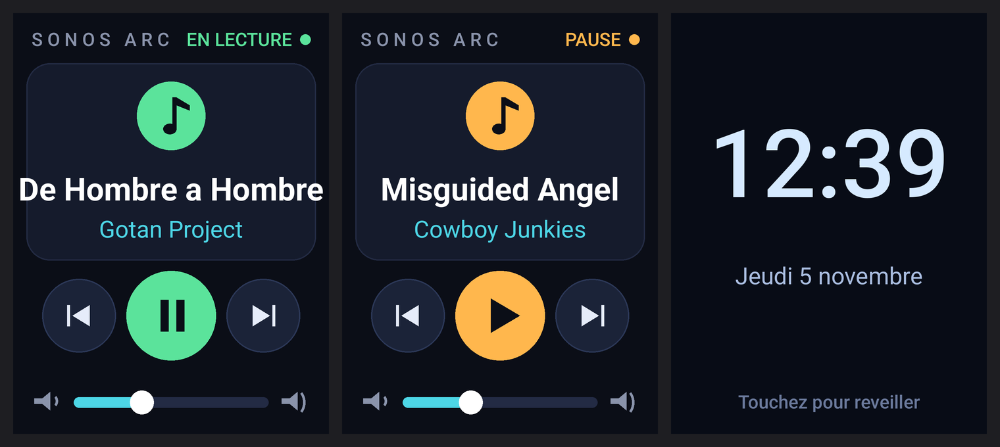

# ESP32 Sonos Touch Panel

  
  
  
  
  

  Dedicated Sonos touchscreen controller using a Sunton ESP32 display, ESPHome and LVGL.

  

<em>Preview of the interface (rendered mockup): playing, paused, sleep clock.</em>

## Overview

A wall or desk controller for a Sonos speaker, built on a Sunton ESP32-2432S028 2.8 inch touchscreen. ESPHome connects it to Home Assistant, which talks to Sonos.

Features:
- album art downloaded from Home Assistant, with a fallback icon when there is no cover
- track title and artist, scrolling when too long, with full accent support
- playback state shown by color (playing, paused, idle)
- round transport buttons: previous, play / pause, next
- volume slider synchronized with Home Assistant
- TV source detected: cover and artist are cleared, and restored when music resumes
- sleep clock with French date, touch to wake
- the screen stays awake while music is playing, and sleeps after 30 seconds otherwise

## Hardware

- Sunton ESP32-2432S028 (ESP32, 2.8 inch 240x320 TFT, XPT2046 resistive touch)
- USB power supply (a power bank works well for portable use)

## Software stack

- ESPHome (tested with 2026.10, ESP-IDF framework)
- Home Assistant with the Sonos integration
- LVGL, through the ESPHome `lvgl` component

## Project structure

    .
    ├── LICENSE
    ├── README.md
    ├── TROUBLESHOOTING.md
    ├── images
    │   └── lvgl-ui-preview.png
    └── esphome
        ├── sunton-2432s028r-sonos.yaml
        └── secrets.example.yaml

## Configuration

1. Copy the example secrets file and edit it:

       cp esphome/secrets.example.yaml esphome/secrets.yaml

   | Key | Meaning |
   | --- | --- |
   | `wifi_ssid`, `wifi_password` | your WiFi credentials |
   | `ha_url` | Home Assistant base URL, without trailing slash (used for album art) |

2. Set your Sonos entity in the `substitutions` block of `esphome/sunton-2432s028r-sonos.yaml`:

       substitutions:
         player: media_player.arc

3. Flash the device. From the repository folder with the ESPHome CLI:

       cd esphome
       esphome run sunton-2432s028r-sonos.yaml

   Or copy the YAML and `secrets.yaml` to your ESPHome Builder folder in Home Assistant and install from there.

## How it works

- **Display**: `mipi_spi` driver (ESP32-2432S028 preset) with LVGL and a 25 % partial buffer, because the board has no PSRAM.
- **Touch**: XPT2046 handled by LVGL, so buttons and the slider are regular widgets (no manual touch zones).
- **Album art**: `online_image` downloads `entity_picture` from Home Assistant. Home Assistant serves PNG, which is decoded while streaming. JPEG would need the whole file in one memory block, which this board cannot provide.
- **TV source**: Home Assistant removes artist and picture attributes on the TV input, so the panel checks the `source` attribute (and a title of `TV`) to clear them.
- **Sleep**: after 30 seconds without touch, and only when Sonos is not playing, the clock page is shown at reduced brightness. Touching the screen wakes it.

## Power supply

For battery usage, the simplest and most reliable option is a standard USB power bank. A custom 18650 battery design is possible but is not part of this project.

GPIO warnings: ESPHome may warn about strapping pins such as GPIO12. This is expected on this board and does not affect normal operation.

## Roadmap

- choose the room (Sonos speaker) from the panel
- automatic brightness
- real photo of the panel in this README

## License

MIT
